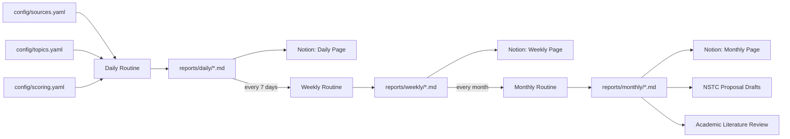

# EKI Research Intelligence

**Enterprise Knowledge Intelligence (EKI) Research Intelligence** is a long-term, Claude-Code-driven research operations repository. It continuously monitors AI literature and enterprise AI product developments, synthesizes findings into structured bilingual (English / Traditional Chinese) reports, and builds a durable knowledge base to support academic writing, proof-of-concept planning, and NSTC (National Science and Technology Council, Taiwan) research proposal preparation.

This is not a one-off analysis project — it is infrastructure for a multi-year research program, designed to run daily, weekly, and monthly cycles with minimal manual overhead.

---

## Project Overview

Enterprise Knowledge Intelligence (EKI) is the research program's core subject: how organizations acquire, structure, retrieve, govern, and act on knowledge using AI systems — spanning retrieval-augmented generation, knowledge graphs, enterprise search, agentic workflows, and knowledge-worker productivity tools.

This repository operationalizes that research program as a **Claude Code routine**: a set of prompts, configuration files, and templates that let Claude Code act as a standing research assistant. Every run pulls from configured scholarly and industry sources, scores findings against the project's research priorities, and writes structured reports into both this repository and a connected Notion workspace.

## Features

- **Continuous literature monitoring** across arXiv, OpenReview, ACL Anthology, IEEE Xplore, ACM Digital Library, Crossref, OpenAlex, and GitHub.
- **Multi-dimensional scoring** of every finding (Academic Score, Enterprise Score, Product Score, Research Potential, Implementation Difficulty) to prioritize attention.
- **Daily / weekly / monthly cadence** with distinct synthesis goals — daily capture, weekly pattern-finding, monthly strategic rollup.
- **Bilingual reporting** (English + Traditional Chinese) suited to both international publication and domestic (Taiwan) research communication, including NSTC proposals.
- **Notion-integrated workflow** — reports are mirrored into a structured Notion database for long-term search and cross-referencing.
- **Claude Code native** — all routines are implemented as Markdown prompts and a global `CLAUDE.md` instruction file, versioned alongside the research output itself.

## Repository Structure

```text
eki-research-intelligence/
├── README.md                  # This file
├── CLAUDE.md                  # Global project instructions for Claude Code
├── LICENSE
├── .gitignore
├── config/                    # Machine-readable configuration
│   ├── topics.yaml            # Research topic taxonomy
│   ├── scoring.yaml           # Scoring rubric definitions
│   ├── notion.yaml            # Notion workspace mapping
│   └── sources.yaml           # Scholarly / industry data sources
├── prompts/                   # Short, cadence-specific routine prompts
│   ├── daily.md
│   ├── weekly.md
│   └── monthly.md
├── templates/                 # Reusable Markdown report templates
│   ├── daily_report.md
│   ├── weekly_report.md
│   └── monthly_report.md
├── docs/                      # Project documentation
│   ├── architecture.md
│   ├── workflow.md
│   ├── roadmap.md
│   └── research_domains.md
├── scripts/                   # Automation / utility scripts
├── reports/                   # Generated output (git-tracked history)
│   ├── daily/
│   ├── weekly/
│   └── monthly/
├── examples/                  # Reference output for calibration
│   └── sample_daily_report.md
└── .github/                   # Issue / PR templates
    ├── ISSUE_TEMPLATE/
    └── PULL_REQUEST_TEMPLATE.md
```

## Workflow



1. **Daily** — Claude Code runs `prompts/daily.md` under the rules in `CLAUDE.md`, scans configured sources, scores new findings, and writes a bilingual daily report to `reports/daily/` and Notion.
2. **Weekly** — `prompts/weekly.md` synthesizes the past 7 daily reports into themes, trend shifts, and a prioritized watchlist.
3. **Monthly** — `prompts/monthly.md` rolls weekly syntheses into a strategic view: research gaps, PoC candidates, and proposal-relevant material for NSTC submissions.

See [docs/workflow.md](docs/workflow.md) for the full operational detail and [docs/architecture.md](docs/architecture.md) for system design.

## Future Roadmap

See [docs/roadmap.md](docs/roadmap.md) for the full phased plan. In short:

- **Phase 1** — Manual-assisted daily/weekly/monthly routines (current).
- **Phase 2** — Automated source ingestion scripts and a local paper database.
- **Phase 3** — Cross-report semantic search and trend dashboards.
- **Phase 4** — NSTC proposal generation pipeline fed directly from monthly rollups.

## License

Released under the [MIT License](LICENSE).
