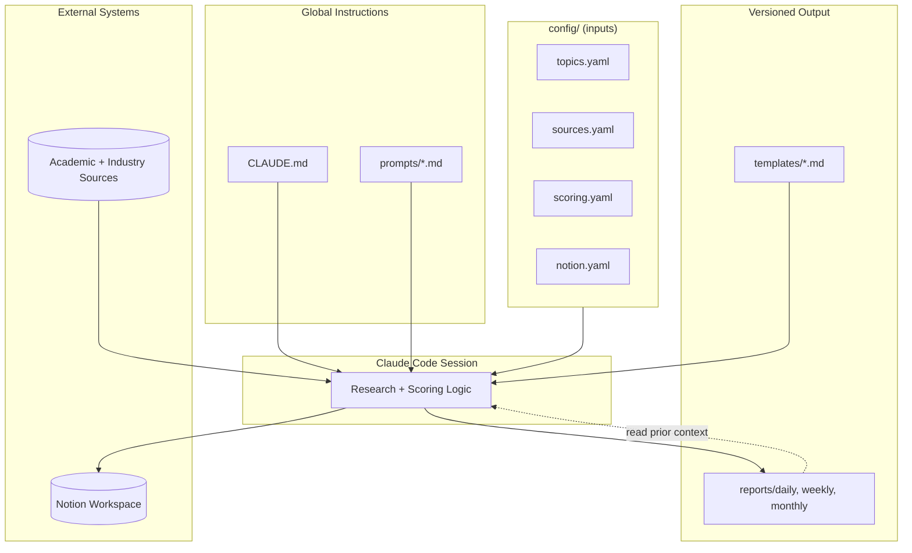

# Architecture

This document describes how the pieces of `eki-research-intelligence` fit together at a system level.

## Design Principle

The repository is a **Claude Code routine**, not a traditional application: there is no long-running service. Each cadence run (daily/weekly/monthly) is a bounded Claude Code session that reads configuration and prior reports, does research work using its tools (web fetch/search, file read/write), and writes new Markdown artifacts plus a Notion mirror. Statelessness between runs is intentional — all state lives in versioned files, not in memory or a database.

## Component Overview

## Layers

### 1. Instruction Layer (`CLAUDE.md`, `prompts/`)

`CLAUDE.md` holds everything that is true regardless of cadence: vision, scope, writing style, bilingual rules, reliability rules. The `prompts/` files hold only what changes per cadence — this separation keeps prompts short and prevents rule drift between daily/weekly/monthly behavior (a rule fixed once in `CLAUDE.md` is fixed everywhere).

### 2. Configuration Layer (`config/`)

Machine-readable YAML that parameterizes the routine without touching prompts:
- `topics.yaml` — what to look for.
- `sources.yaml` — where to look.
- `scoring.yaml` — how to evaluate what's found.
- `notion.yaml` — where to mirror the output.

Changing research direction (e.g., adding a new topic category or source) should require editing config only, never the prompts or `CLAUDE.md`.

### 3. Template Layer (`templates/`)

Defines the exact structure every report must conform to, including the English/中文 pairing required by `CLAUDE.md` §6. Templates are the contract between the Markdown reports and their Notion mirror (`config/notion.yaml` `sync_rules`) — both must stay structurally identical.

### 4. Execution Layer (Claude Code session)

At run time, Claude Code:
1. Loads `CLAUDE.md` (global) and the relevant `prompts/*.md` (cadence-specific).
2. Reads the relevant `config/*.yaml` files.
3. Fetches from sources, filters/scores per rules.
4. Fills the matching template.
5. Writes to `reports/` and syncs to Notion.

### 5. Output Layer (`reports/`, Notion)

`reports/` is the git-tracked, canonical history — every report is a permanent, diffable artifact. Notion is a queryable mirror optimized for cross-referencing and search, not the source of truth. If the two ever diverge, `reports/` wins (see `config/notion.yaml` `sync_rules`).

## Why Git-Tracked Reports Matter

Because every report is committed, the project gets:
- **Auditability** — any score or claim is traceable to the exact commit/session that produced it.
- **Diffability** — score revisions over time (e.g., a finding's Enterprise Score rising after a product launch) show up as clean diffs.
- **Reproducibility** — the `CLAUDE.md`/`config` state that produced a given report is pinned to that commit, so behavior changes are explainable in hindsight.

## Future Architecture (see `docs/roadmap.md`)

Phase 2+ introduces `scripts/` automation for source polling and a local paper-database export, reducing reliance on live fetches during each session and enabling faster incremental runs.
