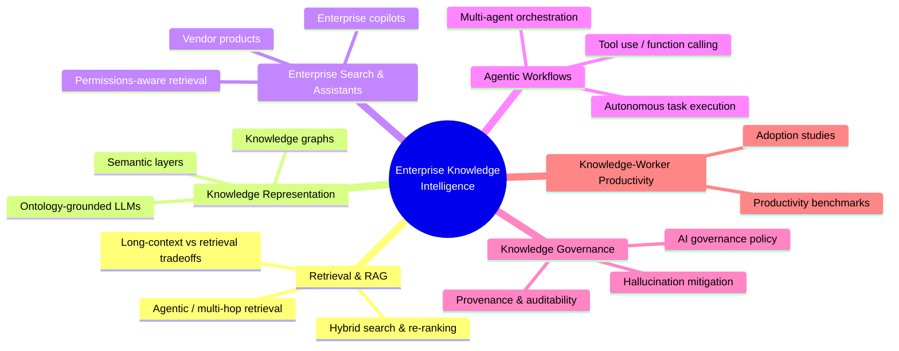

# Research Domains

This document details the six sub-domains that define **Enterprise Knowledge Intelligence (EKI)**, as introduced in `CLAUDE.md` §3. Every finding tracked by this repository should map to at least one domain below; findings that don't map to any domain are likely out of scope (see `CLAUDE.md` §4).

## Domain Map

## Domain Definitions

### 1. Retrieval & RAG

Systems that ground LLM generation in externally retrieved evidence. Core research questions: how to retrieve the *right* evidence efficiently at enterprise scale, how retrieval trades off against ever-larger context windows, and how to evaluate faithfulness of generated answers to retrieved evidence. Maps to `config/topics.yaml` category `rag`.

### 2. Knowledge Representation

How enterprise knowledge is structured so it can be reasoned over — knowledge graphs, ontologies, and semantic/metadata layers that sit between raw enterprise data and LLM-facing interfaces. Central tension: rigid structure (better precision, governance) vs. flexible/emergent structure (better coverage, lower maintenance). Maps to `config/topics.yaml` category `knowledge-representation`.

### 3. Enterprise Search & Assistants

The user-facing layer where employees interact with enterprise knowledge through AI — copilots, internal search, workplace assistants. Distinct from consumer search primarily due to permissioning and multi-tenancy constraints. Maps to `config/topics.yaml` category `enterprise-search`.

### 4. Agentic Workflows

Systems that *act* on enterprise knowledge rather than only answering questions about it — multi-step task execution, tool/API calling, and multi-agent coordination. This is the domain most relevant to PoC candidates, since agentic capability is where lab research most directly threatens/extends existing enterprise software categories. Maps to `config/topics.yaml` category `agentic-workflows`.

### 5. Knowledge Governance

The trust layer: can an organization verify that an AI-derived answer is correct, sourced, and compliant with data-handling policy? Includes hallucination mitigation, citation/provenance mechanisms, and governance policy itself. This domain is weighted heavily in Enterprise Score (`config/scoring.yaml`) because governance gaps are the most common reason enterprise AI pilots stall. Maps to `config/topics.yaml` category `knowledge-governance`.

### 6. Knowledge-Worker Productivity

The empirical, outcomes-focused domain: does AI assistance measurably change how knowledge workers do their jobs? This domain grounds the other five in evidence rather than capability claims, and is especially relevant to the "Expected Contribution" section of NSTC proposals. Maps to `config/topics.yaml` category `knowledge-worker-productivity`.

## Cross-Domain Findings

Findings that span multiple domains (e.g., a governance-aware agentic RAG system) are the most valuable — they typically score highly on Research Potential (`config/scoring.yaml`) because they demonstrate integration challenges that single-domain research doesn't surface. Tag these with all applicable domains rather than forcing a single primary category.
