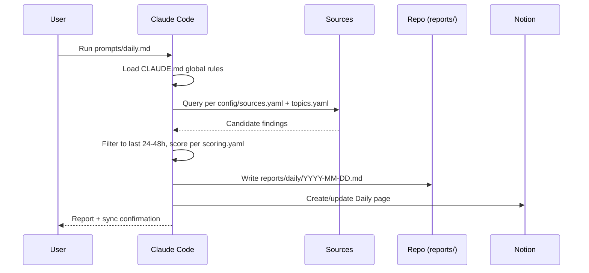

# Workflow

This document describes the operational detail of running EKI Research Intelligence day to day.

## Cadence Overview

| Cadence | Trigger | Input | Output | Prompt |
|---|---|---|---|---|
| Daily | Every day (manual or scheduled) | `config/sources.yaml`, `config/topics.yaml` | `reports/daily/YYYY-MM-DD.md` | `prompts/daily.md` |
| Weekly | Every 7th day | Past 7 daily reports | `reports/weekly/YYYY-Www.md` | `prompts/weekly.md` |
| Monthly | Calendar month end | All weekly reports for the month | `reports/monthly/YYYY-MM.md` | `prompts/monthly.md` |

## Daily Sequence



## Weekly Sequence

Triggered every 7th day (or on demand). Claude Code reads the prior 7 files in `reports/daily/` and synthesizes across them — per `CLAUDE.md` §9, it never re-queries `config/sources.yaml` directly at this cadence. Exact steps are owned by `prompts/weekly.md`; they are not repeated here to avoid the two drifting apart.

## Monthly Sequence

Triggered at calendar month end (or on demand). Claude Code reads the month's files in `reports/weekly/` and produces a strategic rollup. Exact steps are owned by `prompts/monthly.md`; they are not repeated here to avoid the two drifting apart.

## Running a Routine

Routines are invoked as ordinary Claude Code sessions inside this repository. There is no CLI wrapper (yet — see `docs/roadmap.md` Phase 2). A typical invocation:

```text
# From within the repository, with CLAUDE.md auto-loaded:
"Run today's daily routine per prompts/daily.md"
```

Claude Code will load `CLAUDE.md` automatically as project instructions; the cadence prompt is passed explicitly (or referenced by name) to select which routine runs.

## Handling Gaps

- **Missed daily run:** Do not backfill fabricated findings for the missed date. Either skip the date explicitly (note the gap in the next weekly report) or run a best-effort catch-up scoped to the missed window, clearly labeled as a catch-up run.
- **Missed weekly run:** The next weekly run should widen its daily-report window to cover the full unsynthesized period, noted explicitly in the report.
- **Notion sync failure:** governed by `CLAUDE.md` §7 (Notion Workflow) — the rule is the same regardless of which cadence's sync failed, so it is not restated per-cadence here.

## Review Cadence

Because reports accumulate quickly, periodically review `config/topics.yaml` and `config/sources.yaml` (suggested: every monthly rollup) to prune stale topics/sources and add newly relevant ones, keeping the signal-to-noise ratio high.
